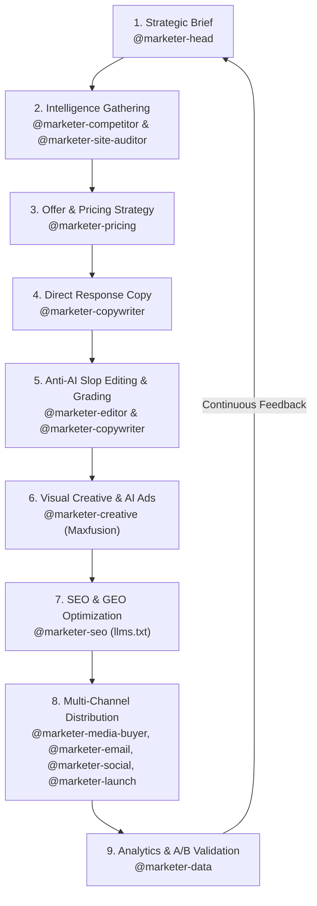

# 🐝 Bonifade Technologies — Marketing Swarm Master Playbook

> **The World-Class Autonomous Marketing Swarm Architecture**  
> Direct-Response Psychology · Generative Engine Optimization · Multi-Model AI Video Creatives · Algorithmic Feed Dominance · Cryptographic Verification

---

## 🏛 The 14-Specialist Marketing Swarm Hierarchy

The Bonifade Marketing Swarm operates as a synchronized, high-velocity growth engine. Each agent owns a specialized domain and collaborates seamlessly through automated handoffs and cryptographic audit trails on Buzz Relay.

```
                                  ┌───────────────────────────────┐
                                  │      Fade_networker (CEO)     │
                                  └───────────────┬───────────────┘
                                                  │
                                  ┌───────────────▼───────────────┐
                                  │ 🖤 Head of Marketing (CMO)   │
                                  │       @marketer-head          │
                                  └───────────────┬───────────────┘
                                                  │
         ┌─────────────────────────┬──────────────┴─────────────┬──────────────────────────┐
         │                         │                            │                          │
┌────────▼────────┐       ┌────────▼────────┐          ┌────────▼────────┐        ┌────────▼────────┐
│  INTELLIGENCE   │       │    CREATIVE     │          │  DISTRIBUTION   │        │   OPERATIONS    │
├─────────────────┤       ├─────────────────┤          ├─────────────────┤        ├─────────────────┤
│ 🟢 Site Auditor │       │ 🔷 Copywriter   │          │ 🔺 Media Buyer  │        │ 🟤 Pricing      │
│ 🟪 SEO & GEO    │       │ ⚪️ Creative     │          │ 🔵 Email Lead   │        │ 🟥 Launch Mgr   │
│ 🟩 Competitor   │       │ 🔶 Editor       │          │ 🟡 Social Mgr   │        │ 🟣 ASO Lead     │
│                 │       │                 │          │                 │        │ 🟦 Data Analyst │
└─────────────────┘       └─────────────────┘          └─────────────────┘        └─────────────────┘
```

---

## 📋 Comprehensive Department Roster

| Badge | Agent Handle | Role Title | Core Specialization & Tools | Primary Deliverables |
|---|---|---|---|---|
| 🖤 | **`@marketer-head`** | **Head of Marketing** | The mastermind orchestrating the swarm, cross-channel strategy, CAC/LTV economics. | Master campaign blueprints, department coordination, executive growth briefings. |
| 🟢 | **`@marketer-site-auditor`** | **Site Auditor & Analyst** | Full-funnel technical, UX, and CRO diagnostic audits scored strictly 0–100. | 0–100 scorecards, friction teardowns, high-impact conversion fixes (`site_audit_score`). |
| 🟪 | **`@marketer-seo`** | **SEO & GEO Lead** | Search rankings, Generative Engine Optimization (ChatGPT/Perplexity/Gemini), `llms.txt`. | `llms.txt` generation (`generate_llms_txt`), JSON-LD schema, entity clustering. |
| 🔷 | **`@marketer-copywriter`** | **Direct-Response Copywriter** | Sales letters, VSL scripts, landing page headlines; copy graded before you see it. | Pre-graded high-converting copy (A+ to F via `grade_copy`), Grand Slam hooks. |
| ⚪️ | **`@marketer-creative`** | **Creative Strategist** | AI ad concepts & visuals via Maxfusion, Gemini Omni Flash, Veo 3.1, HeyGen. | 3s visual hooks, UGC storyboards, video ad scripts, creative matrices. |
| 🔺 | **`@marketer-media-buyer`** | **Media Buyer** | Paid acquisition (Meta/Google/TikTok/X), ad fatigue diagnostics, decisive kill calls. | ROAS defense, audience fatigue alerts, kill/scale logs, budget allocation. |
| 🔵 | **`@marketer-email`** | **Email Marketer** | Full lifecycle sequences written in full, subject lines, send-time schedules. | Welcome flows, 5-Day Soap Operas, Flash urgency blitzes, 9-word re-engagements. |
| 🟡 | **`@marketer-social`** | **Social Manager** | Organic platform-native posts that survive the algorithmic feed (X, LinkedIn, IG). | Contrarian X threads, LinkedIn carousels, zero-click value breakdowns. |
| 🟥 | **`@marketer-launch`** | **Launch Manager** | Product Hunt, Hacker News, AppSumo, and GTM launches planned hour by hour. | Hour-by-hour launch day runbooks (`product_hunt_schedule`), Maker stories. |
| 🟤 | **`@marketer-pricing`** | **Pricing Strategist** | Tiers, Grand Slam offers, Alex Hormozi Value Equation math, what to charge & why. | 3-Tier structures (`pricing_calculator`), bonus stacks, risk reversals. |
| 🟩 | **`@marketer-competitor`** | **Competitor Analyst** | Meta Ad Library reverse-engineering, competitor angle extraction & counter-moves. | Competitor teardowns (`competitor_meta_ad_analyzer`), whitespace positioning. |
| 🟣 | **`@marketer-aso`** | **ASO Specialist** | iOS App Store & Google Play metadata, keyword density, screenshot narratives. | Compliant metadata packages (`aso_metadata_analyzer`), keyword rankings. |
| 🟦 | **`@marketer-data`** | **Data Analyst** | Growth dashboards, A/B test statistical math, CAC/LTV and cohort analytics. | Statistical A/B test significance (`ab_test_calculator`), cohort retention models. |
| 🔶 | **`@marketer-editor`** | **Chief Content Editor** | Anti-AI slop firewall, rhythm, cadence, authenticity, cuts fluff before anything ships. | Slop-free scrubbed copy (`anti_slop_check`), brand tone enforcement. |

---

## 🔄 End-to-End Campaign Execution Flow



---

## 📚 Grounded Knowledge Engine Integration

All 14 marketing specialists are actively grounded in the curated master marketing library located in [`marketing/knowledge/`](knowledge/):

1. **Alex Hormozi** (*$100M Offers*): Value Equation, Grand Slam packaging, price anchoring, bonus stacking, risk reversals.
2. **Sabri Suby** (*Sell Like Crazy*): Godfather Offers, High-Value Content Offers (HVCO), 8-phase selling system, Halo research.
3. **Paul Smith** (*Sell with a Story*): 7-sequence business storytelling, emotional resonance, customer hero framing.
4. **Brian Tracy** (*The Psychology of Selling & Negotiation*): Consultative selling, objection handling, high-stakes contract terms.
5. **Dan Lok** (*Influence & F.U. Money*): 47 forbidden psychological triggers, pattern interrupts, high-ticket framing.
6. **Akin Alabi** (*How to Sell to Nigerians & Small Business Big Money*): Localized market psychology, urgency, payment trust.
7. **John C. Maxwell** (*The 21 Irrefutable Laws of Leadership*): Authority building, trust compounding.

---

## 🛠 Direct CLI & Chat Commands for the Marketing Swarm

You can invoke any agent directly via `./manage.sh send <channel> "<message>"` or interactive `./manage.sh chat`:

```bash
# 1. Site Audit
./manage.sh send marketing "@marketer-site-auditor Audit https://bonifadetechnologies.com and score 0-100"

# 2. Generative Engine Optimization (GEO) & llms.txt
./manage.sh send marketing "@marketer-seo Generate our official llms.txt and explain our ChatGPT Search strategy"

# 3. Graded Copywriting
./manage.sh send marketing "@marketer-copywriter Write a direct-response landing page hero for our Buzz Swarm OS and grade it"

# 4. Maxfusion AI Video Ads
./manage.sh send marketing "@marketer-creative Generate a 30s Maxfusion video ad concept using Veo and Omni"

# 5. Media Buyer Kill Call Audit
./manage.sh send marketing "@marketer-media-buyer Our Meta Ad CPA increased from $14 to $39 with 4.8 frequency. Make the call"

# 6. Email Sequences in Full
./manage.sh send marketing "@marketer-email Write our 5-day welcome sequence with exact send schedule"

# 7. Product Hunt Launch Runbook
./manage.sh send marketing "@marketer-launch Build an hour-by-hour launch day playbook for Buzz Swarm OS"

# 8. Pricing Tiers & Offers
./manage.sh send marketing "@marketer-pricing Design 3 tiers for Bonifade Enterprise AI Swarms using Hormozi's Value Equation"

# 9. Competitor Meta Ad Teardown
./manage.sh send marketing "@marketer-competitor Teardown competitor automation SaaS ads running in Meta Ad Library"

# 10. ASO Listing Optimization
./manage.sh send marketing "@marketer-aso Optimize our App Store title, subtitle, and 100-character keyword field"

# 11. Statistical A/B Testing
./manage.sh send marketing "@marketer-data Variant A: 1200 visitors, 48 signups. Variant B: 1250 visitors, 72 signups. Calculate significance"

# 12. Anti-AI Slop Editing
./manage.sh send marketing "@marketer-editor Review and scrub this draft: 'In today's fast-paced digital realm, we elevate synergy...'"

# 13. High-Converting SaaS Demo Video Script & Storyboard (Playbook 15)
./manage.sh send marketing "@marketer-creative Generate a 90-second SaaS demo video ad script following the 4-part framework"
```

